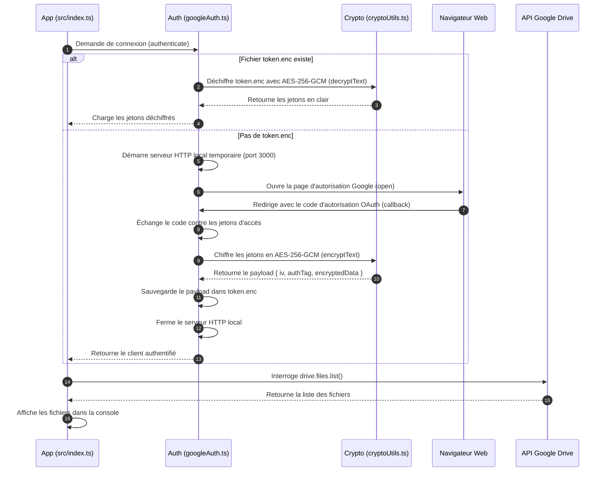
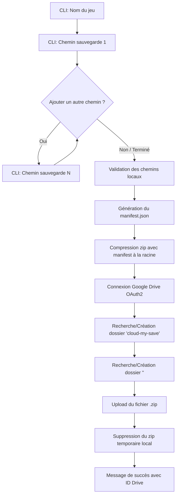
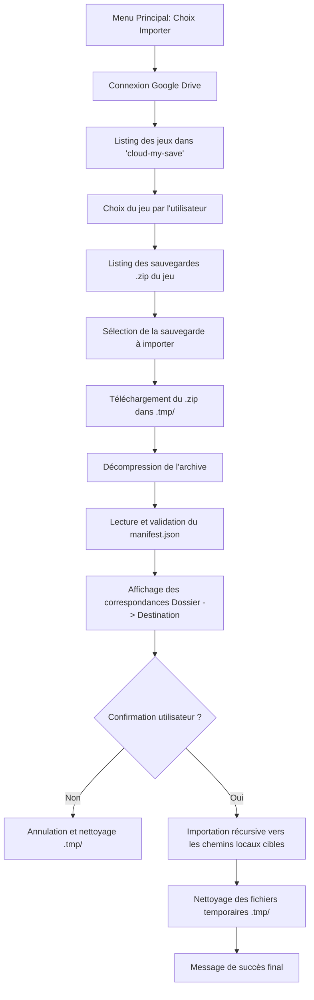

# 📚 Documentation Principale du Projet - cloud-my-save

Bienvenue dans la documentation principale de **cloud-my-save**. Ce document répertorie l'architecture globale, la description détaillée de chaque fichier et dépendance, ainsi que les explications pas-à-pas des fonctionnalités développées.

---

## 📌 1. Présentation du Projet & Fichiers de Base

### 🎯 Objectif du projet
**cloud-my-save** a pour but d'ajouter un système de sauvegarde automatique ou manuelle sur le cloud (Google Drive) pour les jeux vidéo sur PC qui ne disposent pas nativement de cette fonctionnalité (exemples : *Sims 4*, *Scrap Mechanic*, *The Long Drive*, *Minecraft*, etc.).

---

### 🌳 Arborescence Globale du Projet (`tree`)

```text
cloud-my-save/
├── .env
├── .env.example
├── .gitignore
├── .prettierrc
├── explication.md
├── package.json
├── package-lock.json
├── README.md
├── src/
│   ├── auth/
│   │   └── googleAuth.ts
│   ├── cli/
│   │   ├── exportCli.ts
│   │   └── importCli.ts
│   ├── config/
│   │   └── googleConfig.ts
│   ├── services/
│   │   └── driveService.ts
│   ├── utils/
│   │   ├── cryptoUtils.ts
│   │   └── zipUtils.ts
│   └── index.ts
├── token.enc
└── tsconfig.json
```

---

### 🛠️ Explication des Fichiers de Base du Projet

#### 1. `README.md` (Présentation & Roadmap)
* **À quoi il sert :** Fichier de présentation principal décrivant le projet, les jeux ciblés et la feuille de route (*Roadmap*) des fonctionnalités backend et frontend.

#### 2. `package.json` (Carte d'identité du projet Node.js)
* **À quoi il sert :** Fichier central de Node.js. Il définit le nom du projet, la version, la configuration des modules (`"type": "module"` pour ESM), la liste des dépendances installées et les scripts de commande.

#### 3. `package-lock.json` (Verrou des versions)
* **À quoi il sert :** Généré automatiquement par `npm`. Il enregistre la version exacte de chaque sous-dépendance installée afin de garantir un comportement identique sur n'importe quelle machine.

#### 4. `tsconfig.json` (Configuration TypeScript)
* **À quoi il sert :** Configure le compilateur TypeScript (`tsc`). Il indique par exemple le dossier source (`src/`), le dossier compilé (`dist/`) et le mode de résolution (`"moduleResolution": "NodeNext"`).

#### 5. `.env` (Masqué / Clés privées)
* **À quoi il sert :** Contient vos variables d'environnement confidentielles (Google Client ID, Client Secret, et `ENCRYPTION_SECRET`).
* **Sécurité :** Ce fichier **ne doit jamais être partagé ni envoyé sur Git/GitHub** car il contient des secrets d'application.

#### 6. `.env.example` (Modèle public)
* **À quoi il sert :** Modèle d'exemple sans données sensibles. Il indique aux développeurs quelles variables doivent être configurées dans leur propre fichier `.env`.

#### 7. `.gitignore` (Gestion Git)
* **À quoi il sert :** Indique à Git quels fichiers ou dossiers doivent être ignorés et ne jamais être envoyés sur le dépôt distant.
* **Éléments ignorés :**
    * `node_modules/` (dossier très lourd des dépendances)
    * `dist/` (code compilé généré automatiquement)
    * `.env` (données confidentielles)
    * `token.enc` & `token.json` (jetons d'accès utilisateur Google chiffrés ou bruts)
    * `.tmp/` (fichiers temporaires créés lors de la compression ou de l'extraction)
    * `*.zip` (archives de sauvegarde)

#### 8. `.prettierrc` (Conventions de formatage)
* **À quoi il sert :** Configure les règles de formatage de Prettier (ex: dans VS Code) pour imposer l'utilisation d'une indentation fixe de **4 espaces**.

---

### 📦 Explication Détaillée des Dépendances (`package.json`)

#### 🔴 Dépendances de Production (`dependencies`)
1. **`googleapis`** : SDK officiel Google pour Node.js (OAuth2 et Google Drive v3 API).
2. **`dotenv`** : Charge les variables du fichier `.env` dans `process.env`.
3. **`open`** : Ouvre automatiquement la page de connexion Google dans le navigateur par défaut (`open(authUrl)`).
4. **`express`** : Framework Web pour créer des routes et endpoints API.
5. **`archiver`** : Création d'archives compressées `.zip` en streaming ultra-performant.
6. **`adm-zip`** : Décompression et extraction synchrone/asynchrone des archives `.zip` téléchargées.

> 💡 **Pourquoi utiliser deux modules de compression distincts ?**
> * **`archiver` (Écriture seule en streaming) :** Ne sait pas décompresser, mais compresse en flux continu (*streaming*). La consommation de mémoire RAM reste minuscule (~30 Mo) même pour des sauvegardes très lourdes (mondes Minecraft de plusieurs Go), éliminant tout risque de crash `Out of Memory`.
> * **`adm-zip` (Extraction rapide) :** Utilisé pour décompresser et inspecter les archives téléchargées facilement sur le disque.

#### 🔵 Dépendances de Développement (`devDependencies`)
1. **`typescript`** : Compilateur officiel TypeScript (`tsc`).
2. **`tsx`** : Exécuteur TypeScript direct en mode développement (`npm run dev`).
3. **`@types/node`** : Définitions de typage TypeScript pour l'environnement Node.js.
4. **`@types/express`** : Définitions de typage pour Express.
5. **`@types/open`** : Définitions de typage pour le paquet `open`.
6. **`@types/archiver`** : Définitions de typage TypeScript pour `archiver`.
7. **`@types/adm-zip`** : Définitions de typage TypeScript pour `adm-zip`.

---

## 🔒 2. Fonctionnalité : Authentification OAuth & Chiffrement AES-256-GCM

Cette partie correspond au point de la Roadmap Backend : **`- [x] OAuth avec google drive`**.

### 📂 Fichiers dédiés à la fonctionnalité OAuth & Chiffrement

#### 1. `src/utils/cryptoUtils.ts`
* **Rôle :** Module de chiffrement / déchiffrement symétrique fort.
* **À quoi il sert :**
    * Utilise le module natif `crypto` de Node.js avec l'algorithme **AES-256-GCM** (chiffrement authentifié avec vecteur d'initialisation aléatoire `iv` et étiquette d'authentification `authTag`).
    * Dérive une clé binaire de 256 bits à partir de `ENCRYPTION_SECRET` (défini dans `.env`).
    * Empêche l'accès en texte clair aux jetons d'accès et garantit qu'aucune altération de fichier ne puisse passer inaperçue.

#### 2. `src/config/googleConfig.ts`
* **Rôle :** Configuration Google & Chiffrement.
* **À quoi il sert :** Centralise la configuration OAuth, définit le chemin du fichier chiffré (`token.enc`) au sein du projet, et récupère la clé `ENCRYPTION_SECRET`.

#### 3. `src/auth/googleAuth.ts`
* **Rôle :** Logique d'authentification OAuth 2.0, persistance chiffrée, renouvellement automatique de token et déconnexion.
* **À quoi il sert :**
    1. Instancie le client `OAuth2Client`.
    2. Si `token.enc` existe, déchiffre les jetons avec `decryptText()`, teste la validité avec `getAccessToken()` et rafraîchit si expiré.
    3. Si aucun jeton valide n'est présent, démarre un serveur HTTP local temporaire sur le port 3000 avec protection anti-CSRF (`state`).
    4. Ouvre le navigateur sur la page d'autorisation Google via `open()`.
    5. Récupère le code d'autorisation, l'échange contre des jetons d'accès (`access_token` et `refresh_token`), les **chiffre avec `encryptText()`** et enregistre le tout dans `token.enc`.
    6. Fonction `logout()` pour révoquer les accès et purger le fichier local.

#### 4. `token.enc` (Fichier chiffré à la racine du projet)
* **Rôle :** Stockage chiffré local du jeton OAuth.
* **Format :** Fichier JSON contenant l'IV (`iv`), le tag d'authentification (`authTag`) et la donnée chiffrée en hexadécimal (`encryptedData`).

---

### 🔄 Schéma du Flux d'Authentification OAuth Chiffré



---

## 📦 3. Fonctionnalité : Exportation de Sauvegarde (CLI & Google Drive)

Cette partie correspond au point de la Roadmap Backend : **`- [x] Exporter une sauvegarde`**.

### 📂 Fichiers dédiés à l'Exportation

#### 1. `src/utils/zipUtils.ts`
* **Rôle :** Compression, packaging et métadonnées.
* **À quoi il sert :**
    * `generateZipFilename()` : Génère un nom de fichier au format `<NomDuJeu>_jjJ_mmM_aaaaA_hhH_mmM_ssS.zip` (ex: `test_29J_08M_2026A_01H_36M_57S.zip`).
    * `createManifest()` : Génère la fiche `manifest.json` (`game`, `os`, `date`, `timestamp`, et `sources: [{ folder, path }]`).
    * `createZipArchive()` : Compresse les dossiers/fichiers locaux dans une archive `.zip` optimisée (compression niveau 9) et y insère `manifest.json` à la racine.

#### 2. `src/services/driveService.ts`
* **Rôle :** Interactions avec Google Drive pour le stockage.
* **À quoi il sert :**
    * `getOrCreateFolder()` : Recherche un dossier sur Drive par son nom et parent. S'il n'existe pas, il est automatiquement créé.
    * `uploadZipSave()` : Téléverse le fichier `.zip` avec ses métadonnées dans `cloud-my-save/<NomDuJeu>/`.
    * `exportSaveToDrive()` : Coordonne la création de l'arborescence et l'envoi de l'archive.

#### 3. `src/cli/exportCli.ts`
* **Rôle :** Interface interactive CLI pour l'exportation.
* **À quoi il sert :**
    * Collecte le nom du jeu et la liste des chemins de sauvegarde locaux.
    * Valide l'existence et les droits d'accès en lecture (`R_OK`).
    * Lance la compression locale avec `manifest.json`, déclenche l'upload sur Google Drive et supprime le fichier zip temporaire.

---

### 🔄 Schéma du Flux d'Exportation de Sauvegarde



---

## 📥 4. Fonctionnalité : Importation de Sauvegarde (Google Drive ➔ Local)

Cette partie correspond au point de la Roadmap Backend : **`- [x] Importer une sauvegarde`**.

### 📂 Fichiers dédiés à l'Importation

#### 1. `src/services/driveService.ts`
* **Nouvelles fonctions d'import :**
    * `listGamesOnDrive()` : Scanne le dossier `cloud-my-save` sur Google Drive et retourne la liste des jeux disponibles.
    * `listGameSavesOnDrive()` : Liste les sauvegardes `.zip` d'un jeu spécifique, ordonnées de la plus récente à la plus ancienne.
    * `downloadFileFromDrive()` : Télécharge en streaming le fichier `.zip` sélectionné vers un dossier temporaire local (`.tmp/`).

#### 2. `src/utils/zipUtils.ts`
* **Nouvelles fonctions d'extraction et d'importation :**
    * `extractZipArchive()` : Décompresse l'archive `.zip` dans un répertoire temporaire à l'aide de `adm-zip`.
    * `readManifestFromDir()` : Lit et valide le fichier `manifest.json` présent à la racine de l'archive décompressée.
    * `importSourcesFromDir()` : Parcourt chaque élément de `manifest.sources` et importe le dossier/fichier à son emplacement cible sur le disque (création automatique des dossiers parents et copie récursive avec préservation des timestamps).

#### 3. `src/cli/importCli.ts`
* **Rôle :** Interface interactive CLI pour l'importation.
* **À quoi il sert :**
    1. Affiche la liste des jeux disponibles sur Google Drive (ou invite à en saisir un).
    2. Affiche les sauvegardes disponibles avec leur taille et date.
    3. Permet à l'utilisateur de choisir la sauvegarde à importer.
    4. Télécharge le fichier `.zip`, le décompresse, et lit le `manifest.json`.
    5. Affiche le récapitulatif précis des dossiers cibles et demande confirmation.
    6. Exécute l'importation vers les chemins exacts et nettoie les fichiers temporaires.

#### 4. `src/index.ts`
* **Rôle :** Menu principal interactif permettant à l'utilisateur de choisir à tout moment entre l'exportation, l'importation ou quitter.

---

### 🔄 Schéma du Flux d'Importation de Sauvegarde



---

## 🗺️ 5. Roadmap & Prochaines Étapes de Développement

### ⚙️ Backend
- [x] **OAuth avec Google Drive (avec chiffrement local AES-256-GCM)**
- [x] **Exporter une sauvegarde** : Interface interactive CLI, validation des chemins multiples, génération du `manifest.json`, compression `.zip` et téléversement dans `cloud-my-save/<NomDuJeu>/`.
- [x] **Importer une sauvegarde** : Listing des sauvegardes sur Drive, téléchargement, décompression, lecture du `manifest.json` et importation automatique à leurs emplacements d'origine.
- [ ] **Gestion des versions (conflits)** : Horodatage et comparaison des versions avant écrasement.
- [ ] **Plusieurs jeux en même temps** : Organisation par dossiers dédiés dans Google Drive.

### 🎨 Frontend
- [ ] **Bouton importer / exporter**
- [ ] **Sélection du jeu**
- [ ] **Tutoriel / Guide**

---

## 🚀 6. Guide Pratique & Commandes Useful

### 📜 Commandes npm
| Commande | Action |
| :--- | :--- |
| `npm run dev` | Lance le menu principal de l'application en mode interactif (Export ou Import). |
| `npm run build` | Compile l'ensemble du code TypeScript (`src/`) vers `dist/`. |
| `npm start` | Exécute la version compilée depuis `dist/index.js`. |
