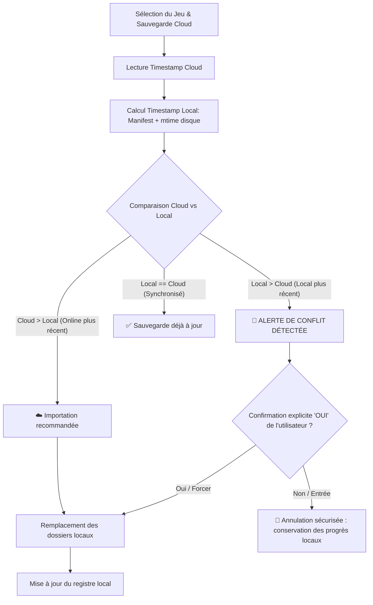

# 📚 Documentation Principale du Projet - cloud-my-save

Bienvenue dans la documentation principale de **cloud-my-save**. Ce document répertorie l'architecture globale, la description détaillée de chaque fichier et dépendance, ainsi que les explications pas-à-pas des fonctionnalités développées.

---

## 📌 1. Présentation du Projet & Fichiers de Base

### 🎯 Objectif du projet
**cloud-my-save** a pour but d'ajouter un système de sauvegarde automatique ou manuelle sur le cloud (Google Drive) pour les jeux vidéo sur PC qui ne disposent pas nativement de cette fonctionnalité (exemples : *Sims 4*, *Scrap Mechanic*, *The Long Drive*, *Minecraft*, etc.).

---

### 🌳 Arborescence Globale du Projet (`tree`)

```text
cloud-my-save/
├── .env
├── .env.example
├── .gitignore
├── .prettierrc
├── explication.md
├── games_registry.json
├── package.json
├── package-lock.json
├── README.md
├── src/
│   ├── auth/
│   │   └── googleAuth.ts
│   ├── cli/
│   │   ├── compareCli.ts
│   │   ├── exportCli.ts
│   │   ├── importCli.ts
│   │   └── initGameCli.ts
│   ├── config/
│   │   └── googleConfig.ts
│   ├── services/
│   │   ├── driveService.ts
│   │   ├── localRegistryService.ts
│   │   └── versionService.ts
│   ├── utils/
│   │   ├── cryptoUtils.ts
│   │   └── zipUtils.ts
│   └── index.ts
├── token.enc
└── tsconfig.json
```

---

### 🛠️ Explication des Fichiers de Base du Projet

#### 1. `README.md` (Présentation & Roadmap)
* **À quoi il sert :** Fichier de présentation principal décrivant le projet, les jeux ciblés et la feuille de route (*Roadmap*) des fonctionnalités backend et frontend.

#### 2. `package.json` (Carte d'identité du projet Node.js)
* **À quoi il sert :** Fichier central de Node.js. Il définit le nom du projet, la version, la configuration des modules (`"type": "module"` pour ESM), la liste des dépendances installées et les scripts de commande.

#### 3. `games_registry.json` (Registre local des manifests)
* **À quoi il sert :** Mémorise sur la machine locale les jeux configurés, leurs chemins d'origine et le dernier manifest appliqué sous le format `{ "games": { [gameName]: SaveManifest } }`.

#### 4. `tsconfig.json` (Configuration TypeScript)
* **À quoi il sert :** Configure le compilateur TypeScript (`tsc`). Il indique par exemple le dossier source (`src/`), le dossier compilé (`dist/`) et le mode de résolution (`"moduleResolution": "NodeNext"`).

#### 5. `.env` (Masqué / Clés privées)
* **À quoi il sert :** Contient vos variables d'environnement confidentielles (Google Client ID, Client Secret, et `ENCRYPTION_SECRET`).
* **Sécurité :** Ce fichier **ne doit jamais être partagé ni envoyé sur Git/GitHub** car il contient des secrets d'application.

#### 6. `.gitignore` (Gestion Git)
* **À quoi il sert :** Indique à Git quels fichiers ou dossiers doivent être ignorés et ne jamais être envoyés sur le dépôt distant (`node_modules/`, `dist/`, `.env`, `token.enc`, `.tmp/`, `games_registry.json`, `data/`, `*.zip`).

---

### 📦 Explication Détaillée des Dépendances (`package.json`)

#### 🔴 Dépendances de Production (`dependencies`)
1. **`googleapis`** : SDK officiel Google pour Node.js (OAuth2 et Google Drive v3 API).
2. **`dotenv`** : Charge les variables du fichier `.env` dans `process.env`.
3. **`open`** : Ouvre automatiquement la page de connexion Google dans le navigateur par défaut (`open(authUrl)`).
4. **`express`** : Framework Web pour créer des routes et endpoints API.
5. **`archiver`** : Création d'archives compressées `.zip` en streaming ultra-performant.
6. **`adm-zip`** : Décompression et extraction synchrone/asynchrone des archives `.zip` téléchargées.

> 💡 **Pourquoi utiliser deux modules de compression distincts ?**
> * **`archiver` (Écriture seule en streaming) :** Ne sait pas décompresser, mais compresse en flux continu (*streaming*). La consommation de mémoire RAM reste minuscule (~30 Mo) même pour des sauvegardes très lourdes (mondes Minecraft de plusieurs Go), éliminant tout risque de crash `Out of Memory`.
> * **`adm-zip` (Extraction rapide) :** Utilisé pour décompresser et inspecter les archives téléchargées facilement sur le disque.

---

## 🔒 2. Fonctionnalité : Authentification OAuth & Chiffrement AES-256-GCM

Cette partie correspond au point de la Roadmap Backend : **`- [x] OAuth avec google drive`**.

### 📂 Fichiers dédiés à l'Authentification

#### 1. `src/utils/cryptoUtils.ts`
* **Rôle :** Chiffrement authentifié symétrique **AES-256-GCM** des jetons de connexion. Dérive une clé de 256 bits à partir de `ENCRYPTION_SECRET`.

#### 2. `src/auth/googleAuth.ts`
* **Rôle :** Authentification OAuth 2.0 avec serveur local temporaire (port 3000), protection anti-CSRF (`state`), renouvellement transparent via `refresh_token` et révocation/déconnexion avec `logout()`.

#### 3. `token.enc`
* **Rôle :** Fichier chiffré stockant les jetons Google localement.

---

## ➕ 3. Fonctionnalité : Initialisation et Localisation d'un Jeu Local

### 🎯 Objectif
Permettre à l'utilisateur de configurer un jeu vidéo sur sa machine en localisant ses dossiers de sauvegarde pour générer un **manifest d'initialisation**.

### 📂 Fichiers dédiés à l'Initialisation

#### 1. `src/cli/initGameCli.ts`
* **Rôle :** Assistant interactif de localisation locale.
* **Fonctionnement :**
    1. Demande le nom du jeu.
    2. Demande et valide le ou les chemins de sauvegarde sur le disque (`fs.existsSync`, `fs.accessSync`).
    3. Détecte le système d'exploitation et calcule l'horodatage initial (`mtime` réel des fichiers).
    4. Génère et enregistre le `manifest.json` d'initialisation dans `games_registry.json`.

#### 2. `src/services/localRegistryService.ts`
* **Rôle :** Gestionnaire de persistance locale (`games_registry.json`).
* **Fonctions clés :** `saveLocalManifest()`, `getRegisteredLocalManifest()`, `listRegisteredLocalManifests()`, `unregisterLocalManifest()`.

---

## 📦 4. Fonctionnalité : Exportation de Sauvegarde (CLI & Google Drive)

Cette partie correspond au point de la Roadmap Backend : **`- [x] Exporter une sauvegarde`**.

### 📂 Fichiers dédiés à l'Exportation

#### 1. `src/utils/zipUtils.ts`
* **Rôle :** Packaging et archivage.
* **Fonctions clés :**
    * `generateZipFilename()` : Génère un nom `<NomDuJeu>_jjJ_mmM_aaaaA_hhH_mmM_ssS.zip`.
    * `createManifest()` : Construit la fiche `manifest.json` (`game`, `os`, `date`, `timestamp`, et `sources: [{ folder, path }]`).
    * `createZipArchive()` : Compresse les dossiers/fichiers et injecte `manifest.json` à la racine de l'archive.

#### 2. `src/services/driveService.ts`
* **Fonctions clés :** `getOrCreateFolder()`, `uploadZipSave()`, `exportSaveToDrive()`.

#### 3. `src/cli/exportCli.ts`
* **Rôle :** Interface interactive pour exporter un jeu vers Google Drive.
* **Réutilisation intelligente :** Si le jeu est déjà initialisé dans `games_registry.json`, l'application propose d'utiliser directement ses chemins sans avoir à les retaper.

---

## 📥 5. Fonctionnalité : Importation de Sauvegarde (Google Drive ➔ Local)

Cette partie correspond au point de la Roadmap Backend : **`- [x] Importer une sauvegarde`**.

### 📂 Fichiers dédiés à l'Importation

#### 1. `src/services/driveService.ts`
* **Fonctions clés :** `listGamesOnDrive()`, `listGameSavesOnDrive()`, `downloadFileFromDrive()`.

#### 2. `src/utils/zipUtils.ts`
* **Fonctions clés :**
    * `extractZipArchive()` : Décompresse le zip dans un dossier temporaire.
    * `readManifestFromDir()` : Lit et valide le `manifest.json`.
    * `importSourcesFromDir()` : Restaure chaque dossier/fichier à son emplacement d'origine avec création automatique des répertoires parents.

#### 3. `src/cli/importCli.ts`
* **Rôle :** Interface interactive pour lister les sauvegardes Cloud d'un jeu, comparer les versions locales/cloud, alerter en cas de conflit et appliquer l'importation.

---

## ⚖️ 6. Fonctionnalité : Gestion des Versions & Résolution des Conflits

Cette partie correspond au point de la Roadmap Backend : **`- [x] Gestion des versions (possible conflit)`**.

### 🎯 Objectif
Empêcher l'écrasement accidentel de progrès locaux récents par une sauvegarde Cloud plus ancienne.

### 📂 Fichiers dédiés à la Gestion des Versions

#### 1. `src/services/versionService.ts`
* **Rôle :** Moteur d'analyse et de comparaison temporelle.
* **Fonctions clés :**
    * `parseTimestampFromSaveFilename()` : Extrait le timestamp milliseconde depuis le nom de fichier `jjJ_mmM_aaaaA_hhH_mmM_ssS`.
    * `getLatestLocalMtime()` : Scanne récursivement les dossiers du jeu sur le disque pour obtenir la date de dernière modification réelle (détecte si le joueur a joué hors-ligne).
    * `compareGameVersions()` : Compare le timestamp Cloud le plus récent et le timestamp local effectif (`Math.max(manifest, mtime_disque)`).

#### 2. `src/cli/compareCli.ts`
* **Rôle :** Tableau de bord récapitulatif des versions pour tous les jeux enregistrés (Local vs Cloud).

---

### 🔄 Règles de Résolution des Conflits



---

## 🗺️ 7. Roadmap & Prochaines Étapes de Développement

### ⚙️ Backend
- [x] **OAuth avec Google Drive (avec chiffrement local AES-256-GCM)**
- [x] **Initialiser / Configurer un jeu localement** : Assistant interactif de localisation des chemins et création du manifest initial dans `games_registry.json`.
- [x] **Exporter une sauvegarde** : Interface interactive CLI, réutilisation des chemins configurés, génération du `manifest.json`, compression `.zip` et téléversement dans `cloud-my-save/<NomDuJeu>/`.
- [x] **Importer une sauvegarde** : Listing des sauvegardes sur Drive, téléchargement, décompression, lecture du `manifest.json` et importation automatique à leurs emplacements d'origine.
- [x] **Gestion des versions (conflits)** : Comparaison Local vs Online, alerte en cas de conflit (Local > Cloud), tableau de bord comparatif et registre local (`games_registry.json`).
- [ ] **Plusieurs jeux en même temps** : Organisation par dossiers dédiés dans Google Drive.

### 🎨 Frontend
- [ ] **Bouton importer / exporter**
- [ ] **Sélection du jeu**
- [ ] **Tutoriel / Guide**

---

## 🚀 8. Guide Pratique & Commandes Useful

### 📜 Commandes npm
| Commande | Action |
| :--- | :--- |
| `npm run dev` | Lance le menu principal interactif (Initialisation, Export, Import, Comparateur). |
| `npm run build` | Compile l'ensemble du code TypeScript (`src/`) vers `dist/`. |
| `npm start` | Exécute la version compilée depuis `dist/index.js`. |
