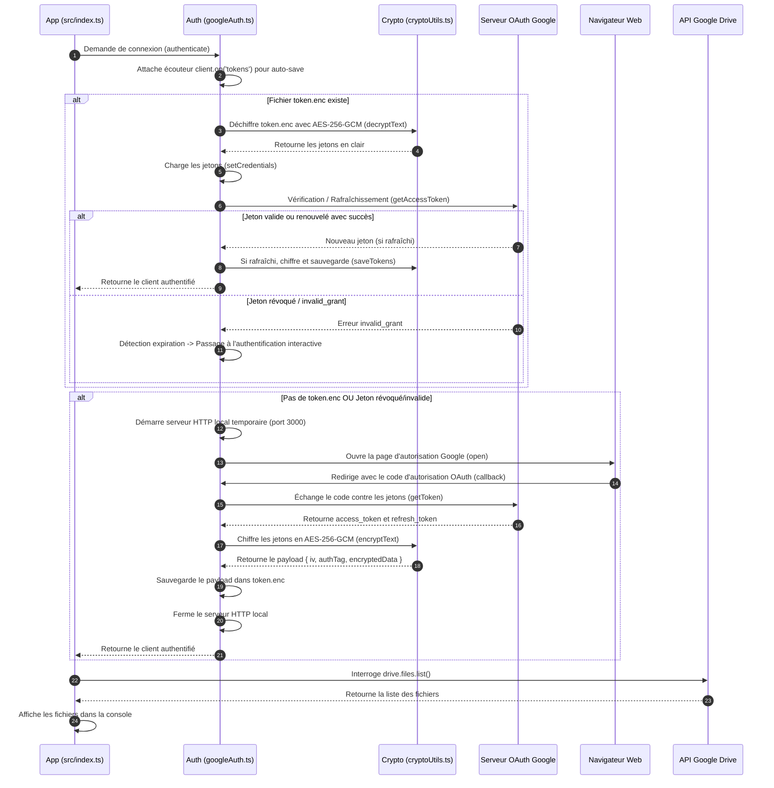
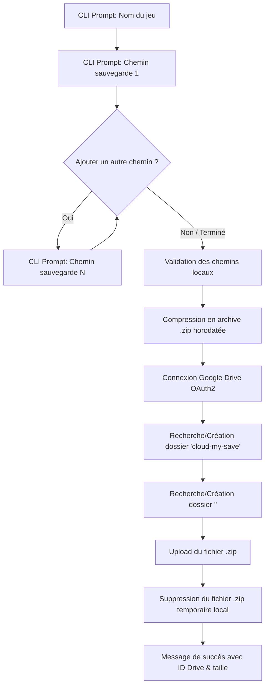

# 📚 Documentation Principale du Projet - cloud-my-save

Bienvenue dans la documentation principale de **cloud-my-save**. Ce document répertorie l'architecture globale, la description détaillée de chaque fichier et dépendance, ainsi que les explications pas-à-pas des fonctionnalités développées.

---

## 📌 1. Présentation du Projet & Fichiers de Base

### 🎯 Objectif du projet
**cloud-my-save** a pour but d'ajouter un système de sauvegarde automatique ou manuelle sur le cloud (Google Drive) pour les jeux vidéo sur PC qui ne disposent pas nativement de cette fonctionnalité (exemples : *Sims 4*, *Scrap Mechanic*, *The Long Drive*, *Minecraft*, etc.).

---

### 🌳 Arborescence Globale du Projet (`tree`)

```text
cloud-my-save/
├── .env
├── .env.example
├── .gitignore
├── .prettierrc
├── explication.md
├── package.json
├── package-lock.json
├── README.md
├── src/
│   ├── auth/
│   │   └── googleAuth.ts
│   ├── cli/
│   │   └── exportCli.ts
│   ├── config/
│   │   └── googleConfig.ts
│   ├── services/
│   │   └── driveService.ts
│   ├── utils/
│   │   ├── cryptoUtils.ts
│   │   └── zipUtils.ts
│   └── index.ts
├── token.enc
└── tsconfig.json
```

---

### 🛠️ Explication des Fichiers de Base du Projet

#### 1. `README.md` (Présentation & Roadmap)
* **À quoi il sert :** Fichier de présentation principal décrivant le projet, les jeux ciblés et la feuille de route (*Roadmap*) des fonctionnalités backend et frontend.

#### 2. `package.json` (Carte d'identité du projet Node.js)
* **À quoi il sert :** Fichier central de Node.js. Il définit le nom du projet, la version, la configuration des modules (`"type": "module"` pour ESM), la liste des dépendances installées et les scripts de commande.

#### 3. `package-lock.json` (Verrou des versions)
* **À quoi il sert :** Généré automatiquement par `npm`. Il enregistre la version exacte de chaque sous-dépendance installée afin de garantir un comportement identique sur n'importe quelle machine.

#### 4. `tsconfig.json` (Configuration TypeScript)
* **À quoi il sert :** Configure le compilateur TypeScript (`tsc`). Il indique par exemple le dossier source (`src/`), le dossier compilé (`dist/`) et le mode de résolution (`"moduleResolution": "NodeNext"`).

#### 5. `.env` (Masqué / Clés privées)
* **À quoi il sert :** Contient vos variables d'environnement confidentielles (Google Client ID, Client Secret, et `ENCRYPTION_SECRET`).
* **Sécurité :** Ce fichier **ne doit jamais être partagé ni envoyé sur Git/GitHub** car il contient des secrets d'application.

#### 6. `.env.example` (Modèle public)
* **À quoi il sert :** Modèle d'exemple sans données sensibles. Il indique aux développeurs quelles variables doivent être configurées dans leur propre fichier `.env`.

#### 7. `.gitignore` (Gestion Git)
* **À quoi il sert :** Indique à Git quels fichiers ou dossiers doivent être ignorés et ne jamais être envoyés sur le dépôt distant.
* **Éléments ignorés :**
    * `node_modules/` (dossier très lourd des dépendances)
    * `dist/` (code compilé généré automatiquement)
    * `.env` (données confidentielles)
    * `token.enc` & `token.json` (jetons d'accès utilisateur Google chiffrés ou bruts)
    * `.tmp/` (fichiers zip temporaires créés lors de la compression avant upload)
    * `*.zip` (archives de sauvegarde)

#### 8. `.prettierrc` (Conventions de formatage)
* **À quoi il sert :** Configure les règles de formatage de Prettier (ex: dans VS Code) pour imposer l'utilisation d'une indentation fixe de **4 espaces**.

---

### 📦 Explication Détaillée des Dépendances (`package.json`)

#### 🔴 Dépendances de Production (`dependencies`)
1. **`googleapis`** : SDK officiel Google pour Node.js (OAuth2 et Google Drive v3 API).
2. **`dotenv`** : Charge les variables du fichier `.env` dans `process.env`.
3. **`open`** : Ouvre automatiquement la page de connexion Google dans le navigateur par défaut (`open(authUrl)`).
4. **`express`** : Framework Web pour créer des routes et endpoints API.
5. **`archiver`** : Création d'archives compressées `.zip` en streaming ultra-performant.

#### 🔵 Dépendances de Développement (`devDependencies`)
1. **`typescript`** : Compilateur officiel TypeScript (`tsc`).
2. **`tsx`** : Exécuteur TypeScript direct en mode développement (`npm run dev`).
3. **`@types/node`** : Définitions de typage TypeScript pour l'environnement Node.js.
4. **`@types/express`** : Définitions de typage pour Express.
5. **`@types/open`** : Définitions de typage pour le paquet `open`.
6. **`@types/archiver`** : Définitions de typage TypeScript pour `archiver`.

---

## 🔒 2. Fonctionnalité : Authentification OAuth & Chiffrement AES-256-GCM

Cette partie correspond au point de la Roadmap Backend : **`- [x] OAuth avec google drive`**.

### 📂 Fichiers dédiés à la fonctionnalité OAuth & Chiffrement

#### 1. `src/utils/cryptoUtils.ts`
* **Rôle :** Module de chiffrement / déchiffrement symétrique fort.
* **À quoi il sert :**
    * Utilise le module natif `crypto` de Node.js avec l'algorithme **AES-256-GCM** (chiffrement authentifié avec vecteur d'initialisation aléatoire `iv` et étiquette d'authentification `authTag`).
    * Dérive une clé binaire de 256 bits à partir de `ENCRYPTION_SECRET` (défini dans `.env`).
    * Empêche l'accès en texte clair aux jetons d'accès et garantit qu'aucune altération de fichier ne puisse passer inaperçue.

#### 2. `src/config/googleConfig.ts`
* **Rôle :** Configuration Google & Chiffrement.
* **À quoi il sert :** Centralise la configuration OAuth, définit le chemin du fichier chiffré (`token.enc`) au sein du projet, et récupère la clé `ENCRYPTION_SECRET`.

#### 3. `src/auth/googleAuth.ts`
* **Rôle :** Logique d'authentification OAuth 2.0, persistance chiffrée et renouvellement automatique des jetons.
* **À quoi il sert :**
    1. Instancie le client `OAuth2Client` et attache un écouteur d'événement (`client.on('tokens', ...)`) pour enregistrer de manière chiffrée tout renouvellement de jeton d'accès en arrière-plan.
    2. Si `token.enc` existe, déchiffre les jetons avec `decryptText()` et les applique au client.
    3. Tente de valider/rafraîchir le jeton d'accès (`client.getAccessToken()`) :
       * Si le jeton est encore valide ou renouvelable via le `refresh_token`, il est utilisé immédiatement (et persisté à jour).
       * Si le jeton est expiré et irrécupérable (ex: jeton révoqué ou `invalid_grant`), l'erreur est interceptée et l'application bascule proprement sur l'authentification interactive.
    4. Si aucun jeton n'existe ou si le jeton est invalide/révoqué, démarre un serveur HTTP local temporaire sur le port 3000.
    5. Ouvre le navigateur sur la page d'autorisation Google via `open()`.
    6. Récupère le code d'autorisation, l'échange contre des jetons d'accès (`access_token` et `refresh_token`), les **chiffre avec `encryptText()`** et enregistre le tout dans `token.enc`.
    7. Ferme le serveur HTTP local.
    8. **Déconnexion (`logout`)** : Révoque les jetons d'accès auprès des serveurs Google (`revokeCredentials()`), réinitialise les identifiants en mémoire et supprime localement le fichier chiffré `token.enc`.

#### 4. `token.enc` (Fichier chiffré à la racine du projet)
* **Rôle :** Stockage chiffré local du jeton OAuth.
* **Format :** Fichier JSON contenant l'IV (`iv`), le tag d'authentification (`authTag`) et la donnée chiffrée en hexadécimal (`encryptedData`).

---

### 🔄 Schéma du Flux d'Authentification & Renouvellement OAuth



---

## 📦 3. Fonctionnalité : Exportation de Sauvegarde (CLI & Google Drive)

Cette partie correspond au point de la Roadmap Backend : **`- [x] Exporter une sauvegarde`**.

### 📂 Fichiers dédiés à l'Exportation

#### 1. `src/utils/zipUtils.ts`
* **Rôle :** Compression et packaging des sauvegardes.
* **À quoi il sert :**
    * Génère un nom de fichier au format `<NomDuJeu>_jjJ_mmM_aaaaA_hhH_mmM_ssS.zip` (ex: `Sims4_28J_08M_2026A_20H_45M_39S.zip`) via `generateZipFilename()`.
    * Compresse un ou plusieurs dossiers/fichiers locaux dans une archive `.zip` optimisée (compression niveau 9) via `createZipArchive()`.

#### 2. `src/services/driveService.ts`
* **Rôle :** Interactions avancées avec l'arborescence Google Drive.
* **À quoi il sert :**
    * `getOrCreateFolder()` : Recherche un dossier sur Drive par son nom et parent. S'il n'existe pas, il est automatiquement créé.
    * `uploadZipSave()` : Téléverse le fichier `.zip` avec ses métadonnées dans un dossier cible.
    * `exportSaveToDrive()` : Coordonne la création de l'arborescence `cloud-my-save/<NomDuJeu>/` et l'envoi de l'archive.

#### 3. `src/cli/exportCli.ts`
* **Rôle :** Interface interactive en ligne de commande (CLI).
* **À quoi il sert :**
    * Demande à l'utilisateur le nom du jeu.
    * Demande le premier chemin de sauvegarde et valide son existence sur le disque.
    * Propose d'ajouter un 2ème, 3ème chemin, etc. jusqu'à validation.
    * Lance la compression locale, déclenche l'upload sur Google Drive, supprime le zip temporaire et affiche un récapitulatif complet.

#### 4. `src/index.ts`
* **Rôle :** Point d'entrée de l'application. Lance directement l'assistant d'exportation CLI.

---

### 🔄 Schéma du Flux d'Exportation de Sauvegarde



---

## 🗺️ 4. Roadmap & Prochaines Étapes de Développement

### ⚙️ Backend
- [x] **OAuth avec Google Drive (avec chiffrement local AES-256-GCM)**
- [x] **Exporter une sauvegarde** : Interface interactive CLI, validation des chemins multiples, compression `.zip` et téléversement dans `cloud-my-save/<NomDuJeu>/`.
- [ ] **Importer une sauvegarde** : Téléchargement depuis Google Drive, décompression et restauration locale.
- [ ] **Gestion des versions (conflits)** : Horodatage et comparaison des versions.
- [ ] **Plusieurs jeux en même temps** : Organisation par dossiers dédiés dans Google Drive.

### 🎨 Frontend
- [ ] **Bouton importer / exporter**
- [ ] **Sélection du jeu**
- [ ] **Tutoriel / Guide**

---

## 🚀 5. Guide Pratique & Commandes Useful

### ⚙️ Configuration initiale
1. Copier le modèle d'environnement :
    ```bash
    cp .env.example .env
    ```
2. Configurer vos clés dans `.env` :
    * `GOOGLE_CLIENT_ID`
    * `GOOGLE_CLIENT_SECRET`
    * `ENCRYPTION_SECRET` (clé de chiffrement de votre choix)

### 📜 Commandes npm
| Commande | Action |
| :--- | :--- |
| `npm run dev` | Lance l'application en mode dev direct avec `tsx`. |
| `npm run build` | Compile le code TypeScript (`src/`) vers `dist/`. |
| `npm start` | Exécute la version compilée depuis `dist/index.js`. |
